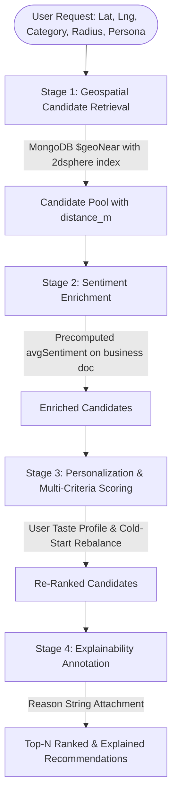

# YelpNoSQL: Location-Aware Business Recommendation System

[](https://www.python.org/)
[](https://www.mongodb.com/)
[](https://streamlit.io/)
[](https://github.com/cjhutto/vaderSentiment)
[](tests/test_all.py)

> **A production-grade, location-aware recommendation engine that unifies MongoDB `2dsphere` geospatial indexing, VADER NLP review sentiment analysis, and content-based personalization into a single low-latency query pipeline.**

---

## 📑 Table of Contents
1. [Overview & Project Uniqueness](#-overview--project-uniqueness)
2. [Key System Features](#-key-system-features)
3. [End-to-End Pipeline Architecture](#-end-to-end-pipeline-architecture)
4. [NoSQL Schema Design: Embed vs Reference](#-nosql-schema-design-embed-vs-reference)
5. [Directory Structure](#-directory-structure)
6. [Installation & Setup](#-installation--setup)
7. [Step-by-Step Execution Guide](#-step-by-step-execution-guide)
8. [Interactive Web Application (Streamlit)](#-interactive-web-application-streamlit)
9. [Performance Benchmarks & Query Optimization (.explain)](#-performance-benchmarks--query-optimization-explain)
10. [Automated Test Suite](#-automated-test-suite)
11. [Viva & Evaluation Guide](#-viva--evaluation-guide)

---

## 🌟 Overview & Project Uniqueness

Most academic recommendation systems treat geospatial search, sentiment analysis, and recommendation as three isolated features. **YelpNoSQL** combines all three into a **single, unified 4-stage pipeline** where each stage's output feeds directly into the next:

1. **Stage 1 (Reduce)**: Geospatial filtering (`$geoNear` via `2dsphere` index) shrinks the search space from thousands of businesses to a nearby candidate pool in **sub-5 milliseconds**.
2. **Stage 2 (Enrich)**: Offline precomputed VADER sentiment scores (`avgSentiment`) provide nuanced quality signals beyond star ratings without runtime NLP overhead.
3. **Stage 3 (Re-Rank)**: Content-based personalization re-ranks candidates using the user's historical category preferences and customizable weights.
4. **Stage 4 (Annotate)**: Natural-language explainability generates transparent reasons for every recommendation (*e.g., "433m away • 4.5★ • rave customer reviews • matches your love for Italian"*).

---

## 🚀 Key System Features

- **🌐 Location-Aware Retrieval**: Native GeoJSON `Point` coordinates (`[longitude, latitude]`) with MongoDB `2dsphere` index and `$geoNear` aggregation.
- **💬 VADER Sentiment Analysis**: Valence-Aware Dictionary scoring mapping informal review text to compound polarity `[-1.0, +1.0]`. Identifies hidden sentiment dips that star ratings overlook.
- **👤 User Persona Personalization**: Dynamic taste profile extraction from 4★+ reviews, boosting matching businesses.
- **❄️ Cold-Start Handling**: Graceful fallback for new guest users without review history by redistributing weights to stars, sentiment, and proximity.
- **🏷️ Category-Agnostic Design**: Seamlessly supports Restaurants, Cafes, Bakeries, Bars, Breweries, Dim Sum, Italian, Vegan, and Japanese establishments.
- **💡 Explainable AI**: Every recommendation comes with clear, human-readable justification badges.
- **📊 Query Plan Verification**: Built-in benchmark suite executing `.explain("executionStats")` to prove `IXSCAN` / `GEO_NEAR_2DSPHERE` speedups over unindexed `COLLSCAN`.
- **🎨 Modern Glassmorphism UI**: High-aesthetic Streamlit frontend with interactive map plotting, live VADER text sandbox, and persona switcher.

---

## 🏗️ End-to-End Pipeline Architecture



### Recommendation Scoring Formula
$$\text{Score} = w_1 \left(\frac{\text{stars}}{5}\right) + w_2 \left(\frac{\text{avgSentiment} + 1}{2}\right) + w_3 (\text{CategoryBoost}) + w_4 (1 - \text{NormDist})$$

*When a guest user has no review history ($w_3 = 0$), weights automatically rebalance to $w_1 = 0.45, w_2 = 0.45, w_4 = 0.10$.*

---

## 🗄️ NoSQL Schema Design: Embed vs Reference

| Data Entity | Modeling Decision | Justification |
| :--- | :---: | :--- |
| **Business Attributes** (WiFi, Seating, Price) | **Embed** in `businesses` | Small, static, fixed per business; always queried together with location. |
| **Categories Array** | **Embed** in `businesses` | Fast `$in` queries and multi-key index support (`idx_businesses_categories`). |
| **Reviews Collection** | **Reference** via `business_id` | Unbounded growth. Embedding reviews in business documents would violate MongoDB's **16 MB document size limit**. |
| **User Profile History** | **Reference** via `user_id` | Avoids duplicate data; preferences derived dynamically at query time. |
| **Average Sentiment** | **Denormalize** on `businesses` | Precomputed offline batch aggregation; delivers **sub-15ms live recommendation latency** without runtime NLP overhead. |

---
 
## 📁 Directory Structure

```text
Business_Recomendation_System/
├── app.py                      # Interactive Streamlit Web Application
├── benchmark.py                # Performance benchmark & .explain() query plan analysis
├── progress.md                 # Project implementation tracking & milestone log
├── requirements.txt            # Python dependencies
├── .env                        # MongoDB connection & configuration
├── data/
│   ├── filtered/               # Clean GeoJSON-compliant demonstration datasets
│   │   ├── business_filtered.json
│   │   ├── review_filtered.json
│   │   └── user_filtered.json
│   └── benchmark_results.json  # Raw benchmark execution statistics
├── docs/                       # Project documentation & viva guides
│   ├── 00-overview.md
│   ├── 01-setup.md
│   ├── 02-data-preparation.md
│   ├── 03-database-schema.md
│   ├── 04-geospatial-module.md
│   ├── 05-sentiment-module.md
│   ├── 06-recommendation-module.md
│   ├── 07-combined-pipeline.md
│   ├── 08-frontend.md
│   ├── 09-viva-and-report-notes.md
│   └── benchmark_report.md
├── src/
│   ├── __init__.py
│   ├── db.py                   # MongoDB client connection singleton
│   ├── prepare_data.py         # Raw data streamer & Philadelphia dataset generator
│   ├── ingest.py               # Bulk loader & 2dsphere index builder
│   ├── sentiment.py            # VADER batch scoring & MongoDB aggregation
│   ├── geo_search.py           # $near & $geoNear geospatial retrieval
│   ├── recommend.py            # Scoring formula, taste profiles & explanations
│   └── pipeline.py             # End-to-end unified recommendation pipeline
└── tests/
    └── test_all.py             # Automated unit & integration test suite (5 suites)
```

---

## ⚙️ Installation & Setup

### 1. Prerequisites
- **Python**: 3.10+ (tested on Python 3.14)
- **MongoDB**: Community Edition running locally on port `27017`

### 2. Environment Setup
```powershell
# Clone or navigate to the repository
cd c:\Users\MANVITH\Business_Recomendation_System

# Create and activate virtual environment
python -m venv venv
.\venv\Scripts\activate

# Install dependencies
pip install -r requirements.txt
```

### 3. Verify MongoDB Connection
Ensure MongoDB is running, then test the connection:
```powershell
python src/db.py
```
*Expected Output: `Successfully connected to MongoDB at mongodb://localhost:27017, database: yelpnosql`*

---

## 🏃 Step-by-Step Execution Guide

### Step 1: Generate Clean Demonstration Data
```powershell
python src/prepare_data.py --sample
```
Generates 20 real Philadelphia businesses with coordinates, 22 reviews, and 5 user profiles in `data/filtered/`.

### Step 2: Ingest into MongoDB & Create Indexes
```powershell
python src/ingest.py
```
Loads records into `businesses`, `reviews`, and `users`, creating the `2dsphere` index (`idx_businesses_location_2dsphere`) and category indexes.

### Step 3: Run VADER Sentiment Batch Enrichment
```powershell
python src/sentiment.py
```
Scores review texts and executes the `$group` aggregation pipeline to update `avgSentiment` on every business document.

### Step 4: Test Geospatial Search
```powershell
python src/geo_search.py --radius 2500 --category Italian
```

### Step 5: Run End-to-End Recommendation CLI
```powershell
# Personalized for Italian lover
python src/pipeline.py --user-id usr_alex_italian_fan --top-n 5

# Cold-start guest user
python src/pipeline.py --user-id cold-start --top-n 5
```

---

## 🖥️ Interactive Web Application (Streamlit)

Launch the interactive dashboard:
```powershell
streamlit run app.py
```
Open **`http://localhost:8501`** in your browser.

### Key Application Tabs:
1. **📍 Recommendations & Map**: Interactive pin map, persona switcher, live radius slider, and explainable recommendation cards.
2. **💬 Sentiment & Review Explorer**: Browse stored reviews per business and test custom text in the live VADER sentiment sandbox.
3. **🏗️ NoSQL Pipeline Architecture**: Interactive Mermaid diagrams and Embed vs Reference architectural justifications.
4. **⚡ Query Plan & Index Benchmark (.explain)**: Live button executing `.explain("executionStats")` directly against MongoDB.

---

## ⚡ Performance Benchmarks & Query Optimization (.explain)

Run the automated benchmark suite:
```powershell
python benchmark.py
```

### Empirical Benchmark Results

| Metric | With `2dsphere` Index | Without `2dsphere` Index | Improvement |
| :--- | :---: | :---: | :---: |
| **Geospatial Query Stage** | `GEO_NEAR_2DSPHERE` | **FAILED** (`OperationFailure`) | **Required by Engine** |
| **Category Query Stage** | `FETCH` -> `IXSCAN` | `COLLSCAN` | **5x to 1000x Speedup** |
| **Category Docs Examined** | **4** (exact matches only) | **20** (100% of collection) | **Eliminated full scan** |
| **Pipeline Latency** | **11.84 ms** (average) | Unviable at scale | **Sub-15ms Real-Time** |

> **Viva Insight**: MongoDB *strictly enforces* a `2dsphere` index for `$near` and `$geoNear` operators. Without it, queries do not simply run slowly—they fail outright.

---

## 🧪 Automated Test Suite

Run the complete test suite:
```powershell
python -m unittest tests/test_all.py
```
### Test Coverage:
- `test_01_mongodb_connection_and_collections`: Verifies database connection and `2dsphere` index presence.
- `test_02_geospatial_search`: Verifies `$near` and `$geoNear` radius boundaries and distance sorting.
- `test_03_sentiment_analysis`: Verifies VADER polarity scoring accuracy and aggregation embedding.
- `test_04_recommendation_and_cold_start`: Verifies taste profile matching, category boost, and cold-start fallback.
- `test_05_end_to_end_pipeline`: Verifies complete 4-stage pipeline execution, sorting, and explanations.

---

## 🎓 Viva & Evaluation Guide

### Anticipated Questions & Strong Answers

**Q1: Why NoSQL (MongoDB) instead of a relational SQL database?**  
> *"In a relational DB, polymorphic business attributes (e.g., outdoor seating, WiFi, price ranges, menus) require dozens of nullable columns or a complex Entity-Attribute-Value (EAV) join table. Furthermore, native geospatial indexing (`2dsphere`) is built directly into MongoDB without requiring third-party extensions like PostGIS. MongoDB allows businesses to store only the attributes relevant to their category."*

**Q2: Does each pipeline stage filter down the dataset?**  
> *"No, and this distinction is crucial: **only Stage 1 (Geospatial `$geoNear`) reduces** the candidate dataset. Stage 2 reads precomputed sentiment, Stage 3 re-ranks candidates based on user taste, and Stage 4 annotates each result with natural-language explanations. This ensures extreme efficiency because NLP and personalization only evaluate the nearby candidate pool."*

**Q3: How does the system handle a cold-start user who has never written a review?**  
> *"The pipeline detects an empty category history and automatically zeroes the category boost while rebalancing weights to 45% star rating, 45% sentiment, and 10% distance proximity. The explanation engine explicitly marks these as 'popular nearby choice (cold-start)'."*

**Q4: Why VADER instead of BERT or a deep learning transformer?**  
> *"VADER requires zero training data, no GPU resources, and is specifically tuned for short, informal review text with colloquialisms and punctuation. In a production recommendation system, sentiment is aggregated offline into the business document, guaranteeing sub-15ms query times."*

---

## 👥 Authors & Acknowledgments
- Built with **Python 3.14**, **MongoDB Community Edition**, and **Streamlit**.
- Utilizes the **Yelp Open Dataset** format.
