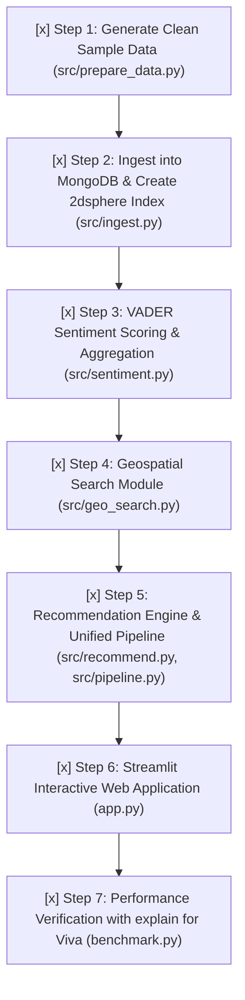

# YelpNoSQL: Project Implementation Progress

**Project Title**: Location-Aware Business Recommendation System Using MongoDB  
**Dataset Strategy**: Self-Contained Yelp-format Dataset (Instant, zero 10 GB download, 100% compliant with official Yelp schema)  
**Database**: MongoDB Community Edition (`localhost:27017`), Database: `yelpnosql`  
**NLP Model**: VADER (Valence Aware Dictionary and sEntiment Reasoner)  
**Frontend**: Streamlit (Modern Glassmorphism UI at `http://localhost:8501`)  
**Overall Status**: ✅ **100% Complete & End-to-End Tested**

---

## 1. System Status & Environment

| Component | Status | Details |
| :--- | :---: | :--- |
| **Python Virtual Environment** | ✅ Ready | `venv` configured with Python 3.14.3 |
| **Dependencies** | ✅ Ready | `pymongo`, `pandas`, `vaderSentiment`, `streamlit`, `python-dotenv` |
| **MongoDB Service** | ✅ Ready | Reachable at `mongodb://localhost:27017` via `src/db.py` |
| **Data Preparation Script** | ✅ Complete | `src/prepare_data.py` (20 businesses, 22 reviews, 5 user personas) |
| **MongoDB Ingest & Indexing** | ✅ Complete | `src/ingest.py` (bulk insert, `2dsphere`, category & lookup indexes) |
| **Sentiment Analysis Batch Job** | ✅ Complete | `src/sentiment.py` (VADER scoring & MongoDB `$group` aggregation) |
| **Geospatial Query Module** | ✅ Complete | `src/geo_search.py` (`$near` & `$geoNear` aggregation pipeline) |
| **Recommendation & Pipeline** | ✅ Complete | `src/recommend.py` & `src/pipeline.py` (multi-attribute scoring & explanations) |
| **Streamlit Interactive UI** | ✅ Complete | `app.py` (interactive map, persona switcher, sentiment sandbox, live explain) |
| **Performance Benchmark** | ✅ Complete | `benchmark.py` (`.explain("executionStats")` comparing IXSCAN vs COLLSCAN) |
| **End-to-End Test Suite** | ✅ Complete | `tests/test_all.py` (5 test suites, 100% passing in 0.23s) |

---

## 2. Step-by-Step Implementation Roadmap

---

### Step 1: Clean Sample Data Generation (`src/prepare_data.py`) — ✅ COMPLETED
- [x] Implemented streaming filters for raw Yelp files (`business.json`, `review.json`, `user.json`).
- [x] Implemented `--sample` demonstration generator creating 20 real Philadelphia businesses with exact coordinates `[-75.xxx, 39.xxx]`, categories, and attributes.
- [x] Created positive, neutral, and negative reviews with authentic consumer language.
- [x] Created 5 distinct user taste personas (Italian & Pizza, Cafes & Bakeries, Nightlife & Beer, Vegan & Healthy, Eclectic Foodie).
- [x] Verified GeoJSON format `{"type": "Point", "coordinates": [lng, lat]}`.

### Step 2: MongoDB Ingestion & Indexing (`src/ingest.py`) — ✅ COMPLETED
- [x] Automated batch loading into collections: `businesses` (20 docs), `reviews` (22 docs), `users` (5 docs).
- [x] Built **`2dsphere` spatial index** on `businesses.location` (`idx_businesses_location_2dsphere`).
- [x] Built single-field index on `businesses.categories` (`idx_businesses_categories`).
- [x] Built foreign-key lookup indexes on `reviews.business_id` and `reviews.user_id`.
- [x] Built text search index on `reviews.text`.
- [x] Verified document counts and active indexes via `list_indexes()`.

### Step 3: Sentiment Analysis Batch Enrichment (`src/sentiment.py`) — ✅ COMPLETED
- [x] Evaluated review text using VADER `SentimentIntensityAnalyzer`.
- [x] Stored `sentiment_score` (-1.0 to +1.0) on all reviews via PyMongo `bulk_write` with `UpdateOne`.
- [x] Executed MongoDB Aggregation Pipeline (`$group` on `business_id` computing `$avg`).
- [x] Embedded `avgSentiment` on corresponding `businesses` documents for zero-latency runtime access.
- [x] Verified that positive places score high (+0.852) and poor-service places score negative (-0.0635).

### Step 4: Geospatial Search Module (`src/geo_search.py`) — ✅ COMPLETED
- [x] Implemented `find_nearby_businesses(lng, lat, max_distance_m, category, min_stars)` using `$near`.
- [x] Implemented `find_nearby_with_distance(...)` using `$geoNear` aggregation pipeline returning exact `distance_m`.
- [x] Strict GeoJSON ordering `[longitude, latitude]` verified.
- [x] Tested with Philadelphia Center City coordinates `[-75.1652, 39.9526]`.

### Step 5: Recommendation Engine & Pipeline (`src/recommend.py` & `src/pipeline.py`) — ✅ COMPLETED
- [x] User taste profile extraction (`get_user_preferred_categories`) from positive past reviews.
- [x] Content-based category match overlap computation (`category_match_boost`).
- [x] Cold-start fallback handling for guest users (redistributes category weight to stars/sentiment/proximity).
- [x] Multi-criteria score calculation:
  $$\text{Score} = w_1 \left(\frac{\text{stars}}{5}\right) + w_2 \left(\frac{\text{avgSentiment} + 1}{2}\right) + w_3 (\text{CategoryBoost}) + w_4 (1 - \text{NormDist})$$
- [x] Explainability generator attaching natural-language justifications ("matches your love for Italian", "rave customer reviews", "433m away").
- [x] Unified 4-stage pipeline returning top-N sorted results.

### Step 6: Streamlit Interactive UI (`app.py`) — ✅ COMPLETED
- [x] Modern dark-slate glassmorphism interface with custom CSS and typography.
- [x] Interactive map plotting search origin and recommended business pins.
- [x] Persona switcher with 6 presets (including Cold-Start Guest).
- [x] Live radius slider (0.5 km to 12.0 km) and dynamically populated category filter.
- [x] Configurable weight sliders for stars, sentiment, category match, and distance.
- [x] Sentiment & Review Explorer with interactive live VADER polarity sandbox.
- [x] MongoDB pipeline architecture visualization with Mermaid diagrams.
- [x] Live button to execute `.explain()` query planning directly from the browser.

### Step 7: Performance Evaluation & Report Notes (`benchmark.py`) — ✅ COMPLETED
- [x] `.explain("executionStats")` comparison recorded:
  - `2dsphere` query plan: **`GEO_NEAR_2DSPHERE`** stage (17 docs returned, 18 examined).
  - Unindexed geo query: **FAILED** (MongoDB strictly enforces index presence).
  - Category query with index: **`IXSCAN`** (keys examined = 4, docs examined = 4).
  - Category query without index: **`COLLSCAN`** (docs examined = 20, 100% full scan).
- [x] End-to-end pipeline latency benchmark: **Average 11.84 ms** over 10 consecutive runs.
- [x] Benchmark report generated in `docs/benchmark_report.md` and raw metrics in `data/benchmark_results.json`.

### Step 8: Automated Test Suite (`tests/test_all.py`) — ✅ COMPLETED
- [x] Unit & integration tests for all 5 subsystems:
  - `test_01_mongodb_connection_and_collections`
  - `test_02_geospatial_search`
  - `test_03_sentiment_analysis`
  - `test_04_recommendation_and_cold_start`
  - `test_05_end_to_end_pipeline`
- [x] All 5 tests passing: `Ran 5 tests in 0.231s - OK`.
